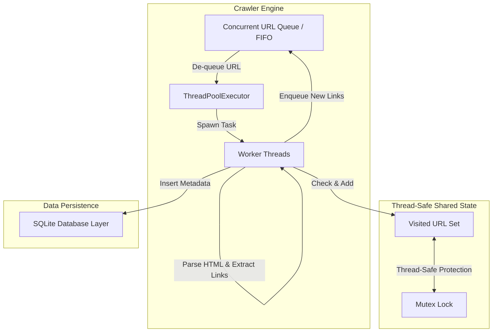

# Multi-Threaded Web Crawler in Python

This document outlines the system architecture, design specifications, and implementation plan for a robust, concurrent web crawler in Python. The crawler will perform breadth-first search (BFS) traversal of web pages, extract and normalize links, track visited URLs, and persist the crawled page metadata into an encapsulated SQLite database.

---

## High-Level Architecture



---

## 1. Single-Threaded BFS Engine (Prototype Phase)

Before scaling to concurrent workers, we define a baseline single-threaded BFS engine. This baseline establishes core utility behavior for link extraction and validation.

### Core Components
1. **Queue Structure**: A standard FIFO queue (`collections.deque`) to store URLs scheduled for exploration.
2. **BeautifulSoup Parser**: Parses raw HTML responses.
3. **URL Normalizer**: Uses `urllib.parse.urljoin` to resolve relative paths against the base URL, strip fragments (`#`), and normalize casing.
4. **BFS Logic**:
   - Dequeue the next URL.
   - Fetch contents with the `requests` library.
   - If successful, parse the response with BeautifulSoup (`html.parser` or `lxml`).
   - Extract links (`<a href="...">`), resolve them to absolute URLs, filter external domains (if restricted), and add unvisited URLs to both the queue and the visited set.

---

## 2. Transitioning to a Concurrent Queue with ThreadPoolExecutor

To scale throughput, the crawler will transition to multi-threading. Since web crawling is heavily network-bound (I/O-bound), Python's Global Interpreter Lock (GIL) will not be a bottleneck. The network I/O operations release the GIL, allowing true concurrent execution across worker threads.

### Concurrency Strategy
- **Thread Management**: Use `concurrent.futures.ThreadPoolExecutor` to manage a pool of reusable worker threads.
- **Task Dispatching**: Rather than submitting individual URLs as static futures, a master-worker or dynamic producer-consumer pattern will be implemented. A thread-safe queue (`queue.Queue`) will handle URL distribution, blocking when empty and coordinating termination.
- **Termination Signal**: The crawler needs a way to stop when the queue is empty *and* all threads have finished active processing. We will track active task counts using `queue.Queue.join()` or an atomic active-worker counter.

---

## 3. Thread-Safe Mechanism & SQLite Database Layer

Shared state across threads (visited set, database writes) requires synchronization to prevent race conditions, data corruption, and write conflicts.

### A. Shared Visited URLs Set
- **Risk**: Python's native `set` is not thread-safe for compound operations (e.g., "check if URL exists, and if not, add it").
- **Solution**: Protect the visited set with a Mutex lock (`threading.Lock`).
  ```python
  class ThreadSafeVisitedSet:
      def __init__(self):
          self._visited = set()
          self._lock = threading.Lock()

      def add_if_new(self, url: str) -> bool:
          with self._lock:
              if url in self._visited:
                  return False
              self._visited.add(url)
              return True
  ```

### B. Encapsulated SQLite Database Layer
- **SQLite Concurrency Constraint**: SQLite does not support concurrent write operations across multiple threads; doing so raises `sqlite3.OperationalError: database is locked`.
- **Architectural Approaches**:
  1. **Option A (Mutex Locked SQLite Helper)**: Wrap all database read/write transactions in a global Mutex lock. This is simple but can introduce lock contention.
  2. **Option B (Database Writer Queue - Recommended)**: Dedicate a single background thread to perform all SQLite writes. Worker threads put write operations (e.g., page metadata, titles, load times) onto a thread-safe `sqlite_queue`. This isolates SQLite interactions to one thread, completely avoiding lock contention.

---

## 4. Edge Cases, Deadlocks, & Network Resiliency

As a Principal Systems Engineer, the following failure modes and mitigation strategies must be addressed:

### A. Network Timeouts and Retries
- **Problem**: Dead or slow servers can hang worker threads indefinitely, exhausting the thread pool.
- **Mitigation**:
  - Enforce explicit connection and read timeouts on every request (e.g., `requests.get(url, timeout=(3.05, 10))`).
  - Implement a retry mechanism with exponential backoff and jitter (using a helper or `urllib3.util.retry.Retry`) to survive transient network failures.

### B. Deadlocks and Lock Contention
- **Problem**: Worker threads waiting on locks while holding other locks, or holding locks while waiting for network calls.
- **Mitigation**:
  - **Rule 1**: Never hold a Mutex lock while making a network request (HTTP GET). Fetch the HTML page first, and only acquire the lock when checking/updating the visited set or inserting to the database.
  - **Rule 2**: Limit nested lock acquisitions. Keep lock duration as short as possible.

### C. Crawler Traps & Memory Exhaustion
- **Problem**: Calendars, dynamically generated paths, or circular redirects can create infinite URL queues.
- **Mitigation**:
  - Enforce a maximum recursion/BFS depth limit.
  - Enforce domain/subdomain scoping (e.g., stay within seed domains).
  - Limit the maximum number of URLs in the visited set to prevent memory exhaustion, or transition to a Bloom filter for extreme scales.

### D. SQLite Write Contention
- **Problem**: Concurrent write attempts causing SQLite database lockouts.
- **Mitigation**:
  - Implement a write queue (`db_queue`) processed by a dedicated single thread.
  - Configure the SQLite connection with an aggressive busy timeout (e.g., `sqlite3.connect(db_path, timeout=30.0)`) and enable Write-Ahead Logging (WAL) mode to allow concurrent readers while writing.

---

## Proposed Changes

We will create a structured Python package inside the workspace containing the crawler modules.

### [Component] Crawler Engine

#### [NEW] [crawler.py](file:///c:/Users/vuppa/Desktop/MultiThreadingPraser/crawler.py)
This module will define the main crawler class, orchestration logic, and link processing utilities.

#### [NEW] [database.py](file:///c:/Users/vuppa/Desktop/MultiThreadingPraser/database.py)
Contains the SQLite database manager, table definitions, and thread-safe writing mechanism (either via Mutex or dedicated queue thread).

#### [NEW] [main.py](file:///c:/Users/vuppa/Desktop/MultiThreadingPraser/main.py)
The CLI entry point for configuring and running the crawler with seeds, depth limits, and concurrency settings.

---

## Verification Plan

### Automated Tests
We will write tests to verify individual modules:
- Mock HTTP responses (using `unittest.mock`) to test page parsing, link resolution, and timeout/error handling.
- Verify thread-safe visited set exclusion logic.
- Verify SQLite concurrent insert integrity by launching multiple threads writing concurrently to the DB.

### Manual Verification
- Run the crawler against a local mock HTTP server (using Python's `http.server`) configured with relative links, circular loops, and artificial latency to verify the BFS traversal correctness, network timeouts, and deadlock avoidance.
